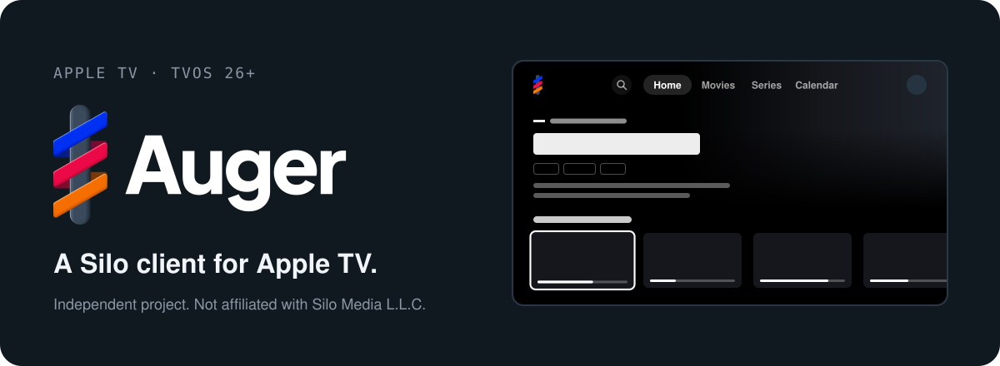
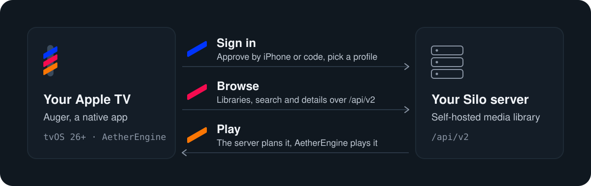

# Auger

<p align="center">
  
</p>

Auger is a third-party Apple TV client for [Silo](https://siloserver.org), the self-hosted media server.
It is a native SwiftUI app for Apple TV running tvOS 26 or later.

## How it works

<p align="center">
  
</p>

1. **Sign in.** Confirm the sign-in from a companion device, or approve a device code from another device, then pick a profile.
2. **Browse.** Auger reads your libraries, search and details through Silo's native `/api/v2`.
3. **Play.** The server plans Direct Play, Remux or a Transcode from what the Apple TV can decode, and [AetherEngine](https://github.com/superuser404notfound/AetherEngine) plays it.

## Install

Auger has no App Store or TestFlight release yet.
Build it from source and install it on your own Apple TV with Xcode.

## Build from source

You need:

- Xcode 26 or later
- [XcodeGen](https://github.com/yonaskolb/XcodeGen)
- Ruby 3.3 with Bundler, for release automation only
- A running Silo server for sign-in, browsing and playback checks

Generate the Xcode project from the checked-in spec and open it:

```sh
cd iosApp
xcodegen generate
open Auger.xcodeproj
```

Build the tvOS app without local signing:

```sh
cd iosApp
xcodebuild build \
  -project Auger.xcodeproj \
  -scheme Auger \
  -destination 'platform=tvOS Simulator,name=Apple TV 4K (3rd generation)' \
  CODE_SIGN_IDENTITY='' CODE_SIGNING_ALLOWED=NO
```

### Sign

Local signing overrides are ignored by Git.

1. Copy `iosApp/Signing/Local.xcconfig.sample` to `iosApp/Signing/Local.xcconfig`.
2. Set your own bundle identifiers, entitlements and development team.
3. Run `xcodegen generate` from `iosApp/`.

A personal Apple Developer team cannot join the production App Group, so Top Shelf rows stay empty with that setup.

### Release

Fastlane lanes live in `fastlane/Fastfile`.
Team IDs, signing repository URLs and App Store Connect API keys come from CI environment variables.
See [docs/release/ci-release.md](docs/release/ci-release.md) and [docs/release/sideloading.md](docs/release/sideloading.md).

<details>
<summary>Build and debug in VS Code</summary>

The checked-in `.vscode` configuration provides recommended extensions, unsigned build tasks, and SweetPad integration for building, running, debugging and Swift code intelligence without the Xcode interface.

1. Install Xcode and select its command-line tools:

   ```sh
   sudo xcode-select --switch /Applications/Xcode.app/Contents/Developer
   sudo xcodebuild -runFirstLaunch
   ```

2. Install XcodeGen: `brew install xcodegen`.
3. Open the repository root in VS Code and accept its extension recommendations.
4. Run `Tasks: Run Task` -> `Auger: Generate Xcode project`.
5. In the SweetPad sidebar, pick the `Auger` scheme and an installed Apple TV simulator destination.
6. Run `SweetPad: Set up Swift code intelligence (BSP)` once, then open a Swift file.
   The generated `buildServer.json` is machine-specific and ignored by Git.

Run `Tasks: Run Task` -> `Auger: Build tvOS` for an unsigned tvOS simulator build.
For tvOS tests, run the `Auger` scheme from the SweetPad or Testing sidebar, or use the `xcodebuild test` command in [CONTRIBUTING.md](CONTRIBUTING.md).
SweetPad drives Xcode's compiler, SDKs, signing tools and simulators, so the full Xcode app is still required.

</details>

<details>
<summary>Repository layout</summary>

- `iosApp/iosApp/` holds the SwiftUI app code, with Apple TV views under `iosApp/iosApp/tvOS/`.
- `iosApp/TopShelf/` holds the tvOS Top Shelf extension.
- `iosApp/Tests/` holds the XCTest target (`AugerTests`).
- `iosApp/Resources/` holds shared resources and bundled open-source licenses.
- `iosApp/Signing/` holds signing defaults and the local override sample.
- `iosApp/project.yml` is the XcodeGen source of truth.
- `fastlane/` holds release automation.
- `docs/` holds design, focus, API, release and playback notes; start with [tvos-focus.md](docs/tvos-focus.md) and [native-api-v2.md](docs/native-api-v2.md).
- `assets/readme/` holds the images on this page.

</details>

## Privacy

Auger connects directly to the Silo server you choose and does not send analytics or diagnostics to a third-party service.
See [PRIVACY.md](PRIVACY.md) for details.

## Contributing

Right now, the most helpful way to contribute is a clear, accurate [issue](https://github.com/Artic0din/Auger-tvOS/issues).
We implement and review changes through our own workflow, so a good issue usually helps more than a pull request.

Pull requests are welcome when a maintainer asks for one.
[CONTRIBUTING.md](CONTRIBUTING.md) explains what makes an issue useful.

Problems with the Silo server or its API belong in [silo-server](https://github.com/Silo-Server/silo-server/issues/new/choose), not here.

## Credits

- **Silo.** Auger connects to [Silo](https://siloserver.org), built by Silo Media L.L.C. and its contributors.
- **TV interface design.** The Apple TV interface follows the [Skyline design guide](docs/skyline-design-guide.md).
- **Palette and type.** The Auger mark's three signal colors and the wordmark's typeface align with [siloserver.org/brand](https://siloserver.org/brand) while using a distinct mark shape.
  The wordmark is set in Plus Jakarta Sans, under the SIL Open Font License, and converted to outlines.
- **[AetherEngine](https://github.com/superuser404notfound/AetherEngine)** by Vincent Herbst plays media under LGPL-3.0-only with its Apple Store / DRM exception.
- **Libraries.** AetherEngine, FFmpeg, LibDovi, SwiftAssRenderer, SwiftLibass, Nuke and other shipped dependencies keep their own licenses; see [THIRD_PARTY_NOTICES.md](THIRD_PARTY_NOTICES.md).

## License and trademarks

Auger is licensed under `AGPL-3.0-or-later` with an additional permission under AGPL section 7 allowing distribution through the Apple App Store and TestFlight despite those platforms' signing, DRM and redistribution terms.
See [LICENSE](LICENSE) and [APPSTORE-EXCEPTION.md](APPSTORE-EXCEPTION.md).
A second additional permission allows combining it with platform SDKs; see [PLATFORM-EXCEPTION.md](PLATFORM-EXCEPTION.md).

Silo and the Silo logo are trademarks of Silo Media L.L.C.
This repository uses the Silo name to describe the server Auger connects to, in line with Silo's [trademark policy](https://github.com/Silo-Server/siloserver.org/blob/main/TRADEMARK.md).

The Auger mark and wordmark are this project's own artwork.

Apple, Apple TV, tvOS and other names belong to their owners.
Third-party code retains its own licenses; see [THIRD_PARTY_NOTICES.md](THIRD_PARTY_NOTICES.md).
